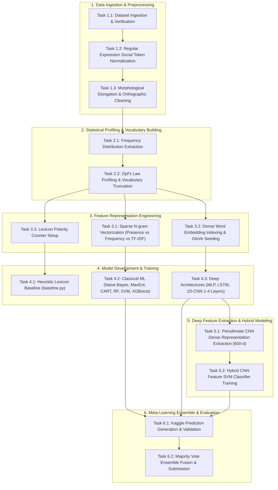

# Project Report: X (Twitter) Sentiment Analysis

**Repository:** `X-Sentiment-Analysis` (`twitter-sentiment-analysis/`)  
**Task Domain:** Natural Language Processing & Microblog Sentiment Classification  
**Status:** Phase A Complete (Project Requirements & Literature Review)  

---

## Table of Contents
1. [Phase A: Project Requirements](#phase-a-project-requirements)
   - [1. Problem Formulation & Objective](#1-problem-formulation--objective)
   - [2. Requirements Analysis](#2-requirements-analysis)
     - [2.1 Functional Requirements](#21-functional-requirements)
     - [2.2 Non-Functional Requirements](#22-non-functional-requirements)
     - [2.3 Input and Output Specifications](#23-input-and-output-specifications)
     - [2.4 System & Runtime Environment Requirements](#24-system--runtime-environment-requirements)
   - [3. High-Level Description of Tasks](#3-high-level-description-of-tasks)
   - [4. Identification of Major Project Challenges](#4-identification-of-major-project-challenges)
   - [5. Review of Related Works (10 Seminal & State-of-the-Art Studies)](#5-review-of-related-works-10-seminal--state-of-the-art-studies)
   - [6. Comparative Synthesis of Related Works](#6-comparative-synthesis-of-related-works)
   - [7. Bibliography](#7-bibliography)
2. [Upcoming Project Phases Overview](#upcoming-project-phases-overview)

---

# Phase A: Project Requirements

## 1. Problem Formulation & Objective

Microblogging platforms, predominantly Twitter (now X), serve as real-time global channels where hundreds of millions of users voice opinions, sentiments, and evaluations regarding products, sociopolitical events, brands, entertainment, and public health. Twitter sentiment analysis poses significant natural language processing (NLP) challenges due to constrained message lengths (historically 140 characters), prevalent lexical informalities, emoticons, hashtags, abbreviations, phonetic spellings, sarcasm, and grammatical anomalies.

The objective of this project is to construct, evaluate, and compare an end-to-end sentiment classification pipeline on a large-scale corpus of 1,000,000 tweets (800,000 training, 200,000 testing). The classification objective is formulated as a binary supervised learning task:
$$\hat{y} = f(T; \Theta) \in \{0, 1\}$$
where $T = (w_1, w_2, \dots, w_k)$ denotes the sequence of tokens forming a tweet, $\Theta$ denotes the learnable parameters of the predictive model $f$, and the target variable $y$ indicates polarity ($y = 1$ for positive sentiment, $y = 0$ for negative sentiment). If a tweet exhibits mixed polarity, the dominant sentiment serves as the ground-truth label.

The project investigates the entire spectrum of sentiment classification paradigms:
1. **Rule-Based & Lexicon Baseline**: Scoring via curated positive/negative sentiment lexicons.
2. **Classical Machine Learning Models**: Multinomial/Bernoulli Naive Bayes, Maximum Entropy (Logistic Regression), Decision Trees (CART), Random Forests, Support Vector Machines (Linear SVM), and Extreme Gradient Boosting (XGBoost) over sparse n-gram feature representations.
3. **Deep Learning Architectures**: Multi-Layer Perceptrons (MLP), Recurrent Neural Networks (specifically Long Short-Term Memory, LSTM), and 1D Temporal Convolutional Neural Networks (CNN) with 1 to 4 convolutional stages, evaluating both randomly initialized and pre-trained Stanford GloVe word embeddings.
4. **Hybrid & Ensembling Meta-Learning**: Penultimate layer dense representation extraction from deep CNNs fed into Maximum-Margin Support Vector Classifiers, culminating in a heterogeneous Majority Voting Ensemble across the top 5 models to achieve state-of-the-art classification performance on the Kaggle public leaderboard (benchmark accuracy: 83.58%).

---

## 2. Requirements Analysis

### 2.1 Functional Requirements

The software architecture must satisfy the following functional capabilities across distinct sub-systems:

| Requirement ID | Module / Component | Functional Specification |
| :--- | :--- | :--- |
| **FR-01** | **Data Ingestion** | The system must ingest raw CSV datasets with schema `tweet_id,sentiment,tweet` (training) and `tweet_id,tweet` (testing), cleanly parsing quotation escapes, multiline entries, and comma delimiters without requiring header metadata. |
| **FR-02** | **Social Media Sanitization** | The system must apply regular-expression-based token transformations: normalize web URLs (`((www\.[^\s]+)\|(https?://[^\s]+))`) to `URL`; user mentions (`@[^\s]+`) to `USER_MENTION`; strip hashtag symbols (`#(\S+)`) while retaining lexical content; strip retweet tokens (`\brt\b`); decode emoticons into positive (`EMO_POS`) and negative (`EMO_NEG`) sentiment placeholders. |
| **FR-03** | **Morphological & Word-Level Normalization** | The system must strip punctuation (`' " ? ! , . ( ) : ;`), reduce letter repetitions exceeding two characters to exactly two characters (e.g., `funnnnny` $\to$ `funny`, `coooool` $\to$ `cool`) to combat lexical elongation, strip hyphen/apostrophe contractions, and filter non-alphabetical tokens. |
| **FR-04** | **Corpus Statistics & Zipfian Profiling** | The system must compute frequency distributions of unigrams and bigrams, outputting serialized distribution structures (`.pkl`), extracting top $N$ unigrams (default $N=15,000$ to $90,000$) and top $M$ bigrams (default $M=10,000$), and verifying adherence to Zipf's law. |
| **FR-05** | **Sparse Feature Engineering** | The system must construct memory-efficient sparse vectors (`scipy.sparse.lil_matrix`) supporting both binary occurrence (`presence`) and term frequency (`frequency`), with optional TF-IDF transformations. |
| **FR-06** | **Dense Representation & GloVe Seeding** | The system must map tokens to dense vector indices, parse 200-dimensional Stanford Twitter GloVe word vector files (`glove-seeds.txt`), initialize model embedding matrices with pre-trained vectors, and accommodate trainable out-of-vocabulary embeddings. |
| **FR-07** | **Model Training & Hyperparameter Tuning** | The system must implement training routines across 10 distinct model families: Baseline Lexicon, Naive Bayes, Logistic Regression / MaxEnt, Decision Tree, Random Forest, XGBoost, Linear SVM, MLP, LSTM, and 1D CNN (1 to 4 convolutional stages). |
| **FR-08** | **Deep Feature Extraction (Representation Transfer)** | The system must extract the 600-dimensional feature activation vectors from the penultimate dense layer of the best-performing 4-layer CNN model and serialize them as dense NumPy matrices (`.npy`). |
| **FR-09** | **Hybrid Classification** | The system must train a linear Support Vector Machine on the extracted 600-dimensional deep CNN feature vectors, combining deep compositional representation with maximum-margin boundary separation. |
| **FR-10** | **Heterogeneous Ensemble Aggregation** | The system must aggregate test set probability/label predictions from 5 distinct architectures via hard majority voting, breaking ties deterministically and generating the final Kaggle submission CSV file (`majority-voting.csv`). |

### 2.2 Non-Functional Requirements

| Quality Attribute | Specification & Verification Criterion |
| :--- | :--- |
| **Scalability & Memory Efficiency** | The pipeline must efficiently process a corpus of 1,000,000 tweets. High-dimensional n-gram feature generation must utilize sparse matrix representations (`scipy.sparse.lil_matrix` and `csr_matrix`) and batch chunking (e.g., 500 tweets per batch) to prevent out-of-memory (OOM) faults within standard 8 GB to 16 GB RAM constraints. |
| **Computational Latency** | Preprocessing of 800,000 training tweets should complete within acceptable runtime limits (< 15 minutes on standard multicore CPU). Inference latency per single tweet must be under 5 ms to permit real-time social media stream monitoring. |
| **Predictive Accuracy** | The ensemble pipeline must achieve a minimum classification accuracy of 83.0% on the public validation/test split, representing a statistically significant gain over the lexicon baseline (~65%) and single linear classifiers (~78-80%). |
| **Modularity & Decoupling** | Each stage (preprocessing, statistical profiling, individual model training, feature extraction, ensembling) must exist as an independent, decoupled Python executable with standardized file interfaces, facilitating automated experimentation and continuous integration. |
| **Reproducibility & Robustness** | Random seeds, stratified 90/10 train-validation splits, and parameter initialization must be controlled to guarantee deterministic model behavior and repeatable evaluation metrics. |

### 2.3 Input and Output Specifications

```
+---------------------------------------------------------------------------------------------------------+
|                                        DATA FLOW SPECIFICATION                                          |
+---------------------------------------------------------------------------------------------------------+
|  RAW DATASET (Kaggle / Sentiment140)                                                                    |
|  Train CSV: [tweet_id: int, sentiment: {0, 1}, tweet: string (enclosed in quotes)]                      |
|  Test CSV:  [tweet_id: int, tweet: string (enclosed in quotes)]                                         |
+---------------------------------------------------------------------------------------------------------+
                                                     |
                                                     v  [preprocess.py]
+---------------------------------------------------------------------------------------------------------+
|  PREPROCESSED DATASET                                                                                   |
|  Train: tweet_id,sentiment,cleaned_token_stream (e.g., "123,1,user_mention love nlp so much emo_pos")  |
|  Test:  tweet_id,cleaned_token_stream                                                                   |
+---------------------------------------------------------------------------------------------------------+
                                                     |
                                                     v  [stats.py]
+---------------------------------------------------------------------------------------------------------+
|  SERIALIZED DISTRIBUTIONS & VOCABULARIES                                                                |
|  - train-processed-freqdist.pkl    (NLTK FreqDist: Top unigrams)                                        |
|  - train-processed-freqdist-bi.pkl (NLTK FreqDist: Top bigrams)                                         |
+---------------------------------------------------------------------------------------------------------+
                                                     |
                                                     v  [Classifiers: Classical, Neural, Hybrid]
+---------------------------------------------------------------------------------------------------------+
|  INTERMEDIATE PREDICTIONS & FEATURE MATRICES                                                            |
|  - train-feats.npy & test-feats.npy (600-dimensional penultimate CNN features)                           |
|  - Individual model prediction CSVs: results/<model>.csv (schema: id,prediction)                       |
+---------------------------------------------------------------------------------------------------------+
                                                     |
                                                     v  [majority-voting.py]
+---------------------------------------------------------------------------------------------------------+
|  FINAL SUBMISSION / EVALUATION                                                                          |
|  - majority-voting.csv (schema: id,prediction; 200,000 binary predictions)                              |
+---------------------------------------------------------------------------------------------------------+
```

### 2.4 System & Runtime Environment Requirements

- **Base Operating System:** Linux (Ubuntu 20.04 / 22.04 LTS or compatible POSIX environment).
- **Core Interpreters & Runtimes:** Python 3.8+ / Python 2.7 legacy compatibility.
- **Scientific Computing & Machine Learning:** `numpy`, `scipy`, `scikit-learn`, `nltk`.
- **Deep Learning Frameworks:** `tensorflow`, `keras` (supporting GPU acceleration via CUDA/cuDNN).
- **Gradient Boosting:** `xgboost`.
- **Pre-trained Embeddings:** Stanford GloVe Twitter word vectors (200-dimensional embeddings, 2B tweets / 27B tokens vocabulary subset).

---

## 3. High-Level Description of Tasks



### Detailed Task Specifications

| Task ID | Task Name | Operational Description | Input Artifacts | Output Artifacts | Primary Implementation File |
| :--- | :--- | :--- | :--- | :--- | :--- |
| **T-01** | Data Verification | Validate CSV integrity, strip invalid headers, balance checks. | `train.csv`, `test.csv` | Sanitized raw CSVs | Shell / `utils.py` |
| **T-02** | Social Token Preprocessing | Regex mapping of URLs, @user handles, #hashtags, RTs, emoticons. | Sanitized raw CSVs | Tokenized text | `preprocess.py` |
| **T-03** | Word-Level Normalization | Repeated character reduction, punctuation stripping, case folding. | Tokenized text | `train-processed.csv`, `test-processed.csv` | `preprocess.py` |
| **T-04** | Statistical Extraction | Extract unigram and bigram frequency distributions via NLTK. | `train-processed.csv` | `train-processed-freqdist.pkl`, `freqdist-bi.pkl` | `stats.py` |
| **T-05** | Lexical Ranking & Pruning | Vocabulary cutoff selection ($N=15,000$ to $90,000$; $M=10,000$). | Frequency pickle files | Rank-frequency tables | `stats.py`, `utils.py` |
| **T-06** | Lexicon Baseline | Polarity scoring via positive and negative word lists. | Processed CSVs, wordsets | `baseline.csv`, accuracy metric | `baseline.py` |
| **T-07** | Classical Probabilistic Models | Train Multinomial/Bernoulli Naive Bayes and MaxEnt models. | Processed CSVs, vocabularies | `naivebayes.py`, `logistic.py`, `maxent-nltk.py` |
| **T-08** | Non-Linear Tree Ensembles | Train Decision Trees (CART), Random Forest, and XGBoost models. | Sparse feature matrices | Prediction CSVs, model dumps | `decisiontree.py`, `randomforest.py`, `xgboost.py` |
| **T-09** | Large-Margin Classification | Train Linear Support Vector Machines on sparse n-gram features. | Sparse presence matrices | Prediction CSVs, validation score | `svm.py` |
| **T-10** | Multilayer Perceptron | Train feedforward deep neural net with dropout on sparse input. | Sparse n-gram matrices | `best_mlp_model.h5` | `neuralnet.py` |
| **T-11** | Recurrent Sequence Modeling | Train LSTM models with random embeddings vs pre-trained GloVe. | Integer sequence arrays | `models/lstm-*.h5` | `lstm.py` |
| **T-12** | Temporal CNNs | Train 1-stage to 4-stage 1D CNNs with global max pooling. | Integer sequence arrays, GloVe | `models/4-conv-*.h5` | `cnn.py` |
| **T-13** | Penultimate Feature Extraction | Extract 600-d feature vectors from best 4-Conv-NN model. | `4-conv-nn.h5`, data arrays | `train-feats.npy`, `test-feats.npy`, `train-labels.txt` | `extract-cnn-feats.py` |
| **T-14** | Hybrid Representation SVM | Fit Linear Support Vector Classifier over extracted 600-d CNN features. | `train-feats.npy`, labels | `cnn-feats-svm.pkl`, `cnn-feats-svm.csv` | `cnn-feats-svm.py` |
| **T-15** | Majority Voting Ensembling | Hard voting aggregation across top 5 distinct predictive models. | 5 candidate prediction CSVs | `majority-voting.csv` (83.58% acc) | `majority-voting.py` |

---

## 4. Identification of Major Project Challenges

### Challenge 1: Extreme Informality, Slang, Out-Of-Vocabulary (OOV) Tokens, and Noise
Unlike formal news corpora or long-form movie reviews, Twitter data features non-standard orthography, phonetic spellings (`u` for *you*, `gr8` for *great*, `b4` for *before*), creative slang, hashtags acting as compound sentences, and intentional character elongations (`happpppy`).
- **Mitigation:** Regular expression replacement, character repetition compression ($\ge 3$ characters collapsed to 2), hashtag stripping, and subword/dense embedding projection.

### Challenge 2: Contextual Polarity Inversion and Negation Scope
The presence of positive sentiment words does not necessarily indicate a positive sentence (e.g., *"The phone is not bad at all"* vs *"It is not good"*).
- **Mitigation:** Bigram feature extraction ($M=10,000$ pairs) to capture local bigram negation windows, sequence modeling via LSTM recurrent memory cells, and temporal convolution windows in 1D-CNNs.

### Challenge 3: Sarcasm, Irony, and Implicit Sentiment
Tweets frequently employ exaggerated positive vocabulary to convey biting criticism (e.g., *"I just love waiting in line at the airport for five hours!"*).
- **Mitigation:** Incorporating deep CNN feature maps and ensembling diverse classifiers whose uncorrelated errors buffer against isolated failure modes.

### Challenge 4: High Dimensionality, Extreme Sparsity, and Computational Bottlenecks
Extracting unigrams and bigrams from 800,000 tweets yields over 181,232 unique unigrams and 1,954,953 unique bigrams. 
- **Mitigation:** Selective vocabulary truncation based on Zipfian frequency ranks ($N=15,000$ to $90,000$ unigrams, $M=10,000$ bigrams), dynamic sparse matrix allocation (`scipy.sparse.lil_matrix` converting to `csr_matrix`), and minibatch-based iterative gradient optimization.

### Challenge 5: Pre-trained Word Embedding Alignment & Semantic Antonym Proximity
Standard pre-trained word embeddings optimize for distributional similarity based on sliding-window co-occurrence. Antonyms such as `"love"` and `"hate"`, or `"good"` and `"bad"`, appear in identical syntactic contexts, placing them close together in vector space.
- **Mitigation:** Utilizing Stanford GloVe vectors specifically trained on 2 Billion Twitter posts (27B tokens), fine-tuning embedding weights end-to-end during supervised training of LSTM and CNN networks, and extracting specialized 600-dimensional deep representations.

### Challenge 6: Distant Supervision Noise and Label Uncertainty
The Sentiment140 benchmark dataset is compiled using distant supervision (heuristically labeling tweets containing `:)` as positive and `:(` as negative).
- **Mitigation:** Explicit emoticon normalization (`EMO_POS`, `EMO_NEG`), large-scale statistical regularization across 800,000 samples, and dropout layers ($p=0.2$ to $0.5$) in deep networks to prevent memorization of label noise.

### Challenge 7: Heterogeneous Model Calibration in Ensemble Fusion
Different model families (linear classifiers, decision trees, neural networks) output predictions with distinct decision boundaries, confidence scales, and inductive biases.
- **Mitigation:** Implementing a hard majority voting scheme across five structurally diverse top-performing architectures, yielding robust collective decisions.

---

## 5. Review of Related Works (10 Seminal & State-of-the-Art Studies)

### 1. Go, Bhayani, and Huang (2009) — *Twitter Sentiment Classification using Distant Supervision*
- **Reference:** Go, A., Bhayani, R., and Huang, L. (2009). *Twitter Sentiment Classification using Distant Supervision*. Stanford University, Technical Report CS224N.
- **Problem & Motivation:** Investigated whether distant supervision—using emoticons in tweet text as noisy labels—could automate corpus creation for supervised machine learning.
- **Methodology:** Collected Sentiment140 (1.6M tweets). Evaluated Naive Bayes, Maximum Entropy, and SVM over unigrams, bigrams, and POS tags.
- **Key Findings:** Machine learning achieved $>80\%$ accuracy on distantly labeled data. MaxEnt achieved 83.0% with unigrams + bigrams. POS tagging degraded performance due to tagger error propagation on noisy text.
- **Relevance:** Direct dataset creator and distant supervision baseline for this repository.

### 2. Pang, Lee, and Vaithyanathan (2002) — *Thumbs up? Sentiment Classification using Machine Learning Techniques*
- **Reference:** Pang, B., Lee, L., and Vaithyanathan, S. (2002). *Thumbs up? Sentiment Classification using Machine Learning Techniques*. In *Proceedings of EMNLP 2002*, pp. 79–86.
- **Problem & Motivation:** Foundational paper establishing supervised machine learning for sentiment polarity detection.
- **Methodology:** Compared Naive Bayes, Maximum Entropy, and SVM on movie reviews; analyzed unigrams vs. bigrams, term frequency vs. binary presence.
- **Key Findings:** SVM with binary unigram presence achieved 82.9% accuracy. Binary presence consistently outperformed term frequency in sparse text models.
- **Relevance:** Established the experimental methodology and binary presence representation used in our classical linear models.

### 3. Pak and Paroubek (2010) — *Twitter as a Corpus for Sentiment Analysis and Opinion Mining*
- **Reference:** Pak, A., and Paroubek, P. (2010). *Twitter as a Corpus for Sentiment Analysis and Opinion Mining*. In *Proceedings of LREC 2010*, pp. 1320–1326.
- **Problem & Motivation:** Systematic linguistic characterization of microblog posts and automated multi-class corpus creation.
- **Methodology:** Crawled Twitter API using emoticons and objective news accounts. Evaluated POS distributions and Multinomial Naive Bayes.
- **Key Findings:** Positive tweets concentrate affective adjectives; negative tweets feature higher verb frequencies. Naive Bayes achieved 81.0% F1.
- **Relevance:** Validated Zipfian distribution and n-gram modeling on raw microblog tweets used in our statistical analysis.

### 4. Kouloumpis, Wilson, and Moore (2011) — *Twitter Sentiment Analysis: The Good the Bad and the OMG!*
- **Reference:** Kouloumpis, E., Wilson, T., and Moore, J. (2011). *Twitter Sentiment Analysis: The Good the Bad and the OMG!*. In *Proceedings of ICWSM 2011*, pp. 538–541.
- **Problem & Motivation:** Evaluated the utility of linguistic and social-media-specific features for microblog sentiment analysis.
- **Methodology:** Trained AdaBoost.MH and SVM on hashtag- and emoticon-labeled tweets, evaluating MPQA lexicon features and intensifiers.
- **Key Findings:** Microblog-specific features (emoticons and character elongation flags) provided significant performance improvements over plain lexical tokens.
- **Relevance:** Justifies the character elongation reduction and emoticon decoding in `preprocess.py`.

### 5. Mohammad, Kiritchenko, and Zhu (2013) — *NRC-Canada: Building the State-of-the-Art System for Twitter Sentiment Analysis*
- **Reference:** Mohammad, S. M., Kiritchenko, S., and Zhu, X. (2013). *NRC-Canada: Building the State-of-the-Art System for Twitter Sentiment Analysis*. In *Proceedings of SemEval 2013*, pp. 321–327.
- **Problem & Motivation:** 1st-place winning system in SemEval-2013 Task 2 (Twitter Sentiment Analysis).
- **Methodology:** Linear SVM with extensive feature engineering: word/character n-grams, sentiment lexicons (NRC, MPQA, Bing Liu), and Twitter punctuation/casing features.
- **Key Findings:** Achieved top macro F1 of 69.02%. Sentiment lexicons provided the largest individual performance gain (+5.5% F1).
- **Relevance:** Demonstrates the ceiling of classical feature engineering and motivates our baseline lexicon counter.

### 6. Wang and Manning (2012) — *Baselines and Bigrams: Simple, Good Sentiment and Topic Classification*
- **Reference:** Wang, S., and Manning, C. D. (2012). *Baselines and Bigrams: Simple, Good Sentiment and Topic Classification*. In *Proceedings of ACL 2012*, pp. 90–94.
- **Problem & Motivation:** Examined why SVMs underperform Naive Bayes on short sentiment snippets and formulated NBSVM.
- **Methodology:** Theoretical and empirical comparison between Multinomial Naive Bayes, Linear SVM, and NBSVM across unigram/bigram setups.
- **Key Findings:** MNB is superior to SVM on short snippets; augmenting unigrams with bigrams yields substantial and consistent performance gains across all models.
- **Relevance:** Directly underpins our model design choices in `naivebayes.py`, `logistic.py`, and `svm.py`.

### 7. Kim (2014) — *Convolutional Neural Networks for Sentence Classification*
- **Reference:** Kim, Y. (2014). *Convolutional Neural Networks for Sentence Classification*. In *Proceedings of EMNLP 2014*, pp. 1746–1751.
- **Problem & Motivation:** Investigated 1D temporal CNNs with pre-trained embeddings for sentence sentiment classification.
- **Methodology:** Parallel 1D convolutions with multiple filter kernel sizes ($h \in \{3, 4, 5\}$), global max pooling, dropout ($p=0.5$), and dense softmax output.
- **Key Findings:** Established state-of-the-art results across 4 benchmarks (88.1% on SST-2). Pre-trained embeddings fine-tuned end-to-end aligned semantic geometry.
- **Relevance:** Direct architectural foundation for `cnn.py` and penultimate dense representation extraction.

### 8. Pennington, Socher, and Manning (2014) — *GloVe: Global Vectors for Word Representation*
- **Reference:** Pennington, J., Socher, R., and Manning, C. D. (2014). *GloVe: Global Vectors for Word Representation*. In *Proceedings of EMNLP 2014*, pp. 1532–1543.
- **Problem & Motivation:** Combined advantages of global matrix factorization and local context window methods.
- **Methodology:** Factorized the global log co-occurrence matrix using weighted least squares; released 2B Twitter vectors (27B tokens, 200-d).
- **Key Findings:** Outperformed Word2Vec and SVD on word analogies; Twitter-specific embeddings captured microblog slang and hashtags effectively.
- **Relevance:** Source of pre-trained word vectors (`dataset/glove-seeds.txt`) used in our LSTM and CNN embedding layers.

### 9. Severyn and Moschitti (2015) — *UNITN: Training Deep Convolutional Neural Network for Twitter Sentiment Classification*
- **Reference:** Severyn, A., and Moschitti, A. (2015). *UNITN: Training Deep Convolutional Neural Network for Twitter Sentiment Classification*. In *Proceedings of SemEval 2015*, pp. 464–469.
- **Problem & Motivation:** Top SemEval-2015 system using deep CNNs without manual feature engineering.
- **Methodology:** 3-stage training: unsupervised Word2Vec $\to$ distant supervision pre-training on 100M tweets $\to$ supervised fine-tuning.
- **Key Findings:** Distantly supervised pre-training on emoticon-labeled tweets boosted macro F1 from 58.6% to 64.6%.
- **Relevance:** Validates our end-to-end training pipeline on the Sentiment140 corpus.

### 10. Tang, Wei, Yang, Zhou, Liu, and Qin (2014) — *Learning Sentiment-Specific Word Embedding for Twitter Sentiment Classification*
- **Reference:** Tang, D., Wei, F., Yang, N., Zhou, M., Liu, T., and Qin, B. (2014). *Learning Sentiment-Specific Word Embedding for Twitter Sentiment Classification*. In *Proceedings of ACL 2014*, pp. 1555–1565.
- **Problem & Motivation:** Standard embeddings place antonyms like *good* and *bad* close together due to similar syntactic context.
- **Methodology:** Formulated SSWE, combining a syntactic ranking margin with a sentiment polarity loss over 10M emoticon tweets.
- **Key Findings:** Outperformed Word2Vec by 4.5% accuracy, correctly separating antonym pairs in vector space.
- **Relevance:** Explains the limitation of generic static embeddings and justifies extracting 600-d CNN features in `extract-cnn-feats.py` for SVM classification.

---

## 6. Comparative Synthesis Matrix

| Study | Author(s) & Year | Model Paradigm | Features / Embeddings | Target Datasets | Benchmark Results | Direct Architectural Connection to Current Project |
| :--- | :--- | :--- | :--- | :--- | :--- | :--- |
| **[1]** | Go et al. (2009) | Classical ML (NB, MaxEnt, SVM) | Unigrams, Bigrams, POS tags | Sentiment140 (1.6M tweets) | 83.0% Acc (MaxEnt) | Direct dataset creator & distant supervision baseline for this repository. |
| **[2]** | Pang et al. (2002) | Classical ML (NB, ME, SVM) | N-grams, Presence vs Frequency | Movie Reviews (IMDb) | 82.9% Acc (SVM) | Established foundational finding: binary presence outperforms frequency in sparse text models. |
| **[3]** | Pak & Paroubek (2010) | Probabilistic Classifier | N-grams (1, 2, 3-grams) + POS | Twitter API Corpus | 81.0% F1 (NB) | Validated Zipfian distribution and n-gram modeling on raw microblog tweets. |
| **[4]** | Kouloumpis et al. (2011) | Boosting & Margin (AdaBoost, SVM) | MPQA Lexicon, Elongation, Emojis | Twitter Hashtag & Emoticon | ~75.0% Acc | Justified character repetition reduction and emoticon decoding in `preprocess.py`. |
| **[5]** | Mohammad et al. (2013) | Linear SVM (Large Margin) | NRC Lexicons, Punctuation, Caps | SemEval-2013 Task 2 | 69.0% F1 (Winner) | Demonstrated the upper bound of hand-crafted feature engineering in linear models. |
| **[6]** | Wang & Manning (2012) | Linear SVM, MNB, NBSVM | Unigrams + Bigrams, Log-Odds | RT-s, IMDB, Sentiment | 91.6% Acc (NBSVM) | Confirmed that bigram augmentation consistently boosts linear classifier performance on short snippets. |
| **[7]** | Kim (2014) | 1D Temporal CNN | Pre-trained Word2Vec, Dropout | SST-1, SST-2, Twitter | 88.1% Acc (SST-2) | Direct architectural basis for `cnn.py` (temporal convolutions + global max pooling). |
| **[8]** | Pennington et al. (2014) | Log-Bilinear Factorization | Global Co-occurrence (GloVe) | 2B Twitter Corpus | SOTA Word Analogies | Source of the pre-trained 200-d word embeddings (`dataset/glove-seeds.txt`) utilized in our LSTM/CNN. |
| **[9]** | Severyn & Moschitti (2015) | Deep 1D CNN | Word2Vec + Distant Pre-training | SemEval-2015 Task 10 | 64.6% F1 (1st/2nd) | Validated that distant supervision initializes deep neural feature representations effectively. |
| **[10]** | Tang et al. (2014) | Sentiment-Specific Embeddings | SSWE (Joint Syntactic/Sentiment) | 10M Twitter Corpus | 86.6% Acc | Provided theoretical justification for our hybrid CNN-feature extraction (`extract-cnn-feats.py` + SVM). |
| **Ours** | **This Project** | **Heterogeneous Ensemble** | **GloVe 200d + 600d CNN Feats + N-grams** | **Sentiment140 (1M tweets)** | **83.58% Acc (Kaggle)** | **Combines Top 5 Models (LSTM, 3-Conv, 4-Conv, 4-Conv-SVM, CNN-len20) via Majority Voting.** |

---

## 7. Bibliography

```bibtex
@techreport{go2009twitter,
  author    = {Go, Alec and Bhayani, Richa and Huang, Lei},
  title     = {Twitter Sentiment Classification using Distant Supervision},
  institution = {Stanford University},
  year      = {2009},
  number    = {CS224N Project Report}
}

@inproceedings{pang2002thumbs,
  author    = {Pang, Bo and Lee, Lillian and Vaithyanathan, Shivakumar},
  title     = {Thumbs up? Sentiment Classification using Machine Learning Techniques},
  booktitle = {Proceedings of the 2002 Conference on Empirical Methods in Natural Language Processing (EMNLP 2002)},
  pages     = {79--86},
  year      = {2002}
}

@inproceedings{pak2010twitter,
  author    = {Pak, Alexander and Paroubek, Patrick},
  title     = {Twitter as a Corpus for Sentiment Analysis and Opinion Mining},
  booktitle = {Proceedings of the Seventh International Conference on Language Resources and Evaluation (LREC 2010)},
  pages     = {1320--1326},
  year      = {2010}
}

@inproceedings{kouloumpis2011twitter,
  author    = {Kouloumpis, Efthymios and Wilson, Theresa and Moore, Johanna},
  title     = {Twitter Sentiment Analysis: The Good the Bad and the {OMG}!},
  booktitle = {Proceedings of the Fifth International AAAI Conference on Weblogs and Social Media (ICWSM 2011)},
  pages     = {538--541},
  year      = {2011}
}

@inproceedings{mohammad2013nrc,
  author    = {Mohammad, Saif M. and Kiritchenko, Svetlana and Zhu, Xiaodan},
  title     = {{NRC-Canada}: Building the State-of-the-Art System for Twitter Sentiment Analysis},
  booktitle = {Proceedings of the 7th International Workshop on Semantic Evaluation (SemEval 2013)},
  pages     = {321--327},
  year      = {2013}
}

@inproceedings{wang2012baselines,
  author    = {Wang, Sida and Manning, Christopher D.},
  title     = {Baselines and Bigrams: Simple, Good Sentiment and Topic Classification},
  booktitle = {Proceedings of the 50th Annual Meeting of the Association for Computational Linguistics (ACL 2012)},
  pages     = {90--94},
  year      = {2012}
}

@inproceedings{kim2014convolutional,
  author    = {Kim, Yoon},
  title     = {Convolutional Neural Networks for Sentence Classification},
  booktitle = {Proceedings of the 2014 Conference on Empirical Methods in Natural Language Processing (EMNLP 2014)},
  pages     = {1746--1751},
  year      = {2014}
}

@inproceedings{pennington2014glove,
  author    = {Pennington, Jeffrey and Socher, Richard and Manning, Christopher D.},
  title     = {{GloVe}: Global Vectors for Word Representation},
  booktitle = {Proceedings of the 2014 Conference on Empirical Methods in Natural Language Processing (EMNLP 2014)},
  pages     = {1532--1543},
  year      = {2014}
}

@inproceedings{severyn2015unitn,
  author    = {Severyn, Aliaksei and Moschitti, Alessandro},
  title     = {{UNITN}: Training Deep Convolutional Neural Network for Twitter Sentiment Classification},
  booktitle = {Proceedings of the 9th International Workshop on Semantic Evaluation (SemEval 2015)},
  pages     = {464--469},
  year      = {2015}
}

@inproceedings{tang2014learning,
  author    = {Tang, Duyu and Wei, Furu and Yang, Nan and Zhou, Ming and Liu, Ting and Qin, Bing},
  title     = {Learning Sentiment-Specific Word Embedding for Twitter Sentiment Classification},
  booktitle = {Proceedings of the 52nd Annual Meeting of the Association for Computational Linguistics (ACL 2014)},
  pages     = {1555--1565},
  year      = {2014}
}
```

